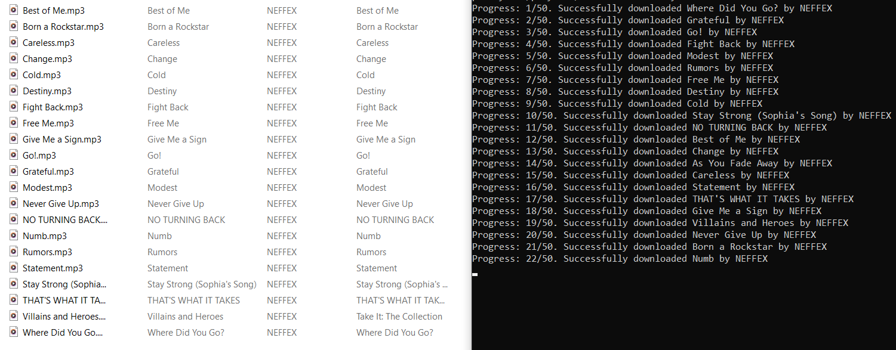
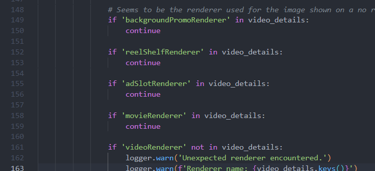
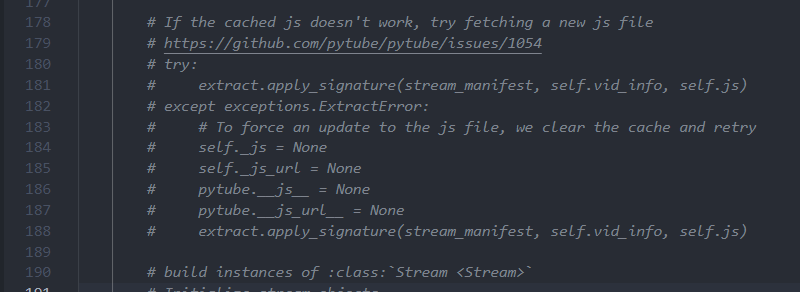

# SpotifyDownloader


> [!WARNING]
> **This project is archived and no longer maintained.** It relied on a YouTube downloading library that broke, so it no longer works as-is, and I'm not planning to fix it or provide support. Better maintained tools exist now, so please look for one of those instead. The info below is kept for reference only 📦

Welcome! 👋 This was my learning project: a command line program that downloads playlists and songs from Spotify for free (no Spotify premium needed, and it doesn't even need to know anything about your personal account, to be honest).

## 📷 Preview



## ✨ Features

- **Playlists**: Download Spotify playlists with just 1 url
- **Songs**: Download Spotify song with just 1 url
- **Metadata**: All needed metadata comes with the songs (name, artists, album and cover art)
- **Cutting**: You can "cut out" a piece of your playlist by using flags when running the program
- **Progress tracking**: The program informs you about progress after every downloaded song, so you don't have to sit in front of your computer
- **Safety**: It was designed to handle songs with the same name, age restrictions etc. (there still might be unexpected errors, but the program informs you about them)

## 📥 Installation

These are the steps the program was designed around (they are not guaranteed to work anymore):

1. **Give a star to this repo if you find it interesting or useful** ⭐\
    **Thanks ❤️**

2. **Clone the repository**:

   ```bash
   git clone https://github.com/Heir-of-God/SpotifyDownloader
   ```

3. **Install dependencies**:

   ```bash
   cd SpotifyDownloader
   pip install -r requirements.txt
   ```

4. **Create Spotify API app**: \
    To grab information from Spotify you need a Spotify API app. Here is how to create it in 3 steps:
    1. Go to https://developer.spotify.com/. Create or login into your account.
    2. After agreeing to all their requirements, you need to create the application. Click on your profile -> Dashboard -> Create app. Enter any app name, description, leave website empty and add to redirect URIs just http://localhost/. In API choose only "Web API" and click save.
    3. After creating the app go to its page, click settings and from "Basic Information" you will need client id and client secret. Go to the next step with this information.

5. **Set up environment variables**: \
    `access.py` reads your credentials from environment variables (via python-dotenv), so nothing is hardcoded in the code.
   - Create a `.env` file in the root directory (it is listed in `.gitignore`, never commit it).
   - Define the following variables:
     - `CLIENT_ID`: your client id from the Spotify API app
     - `CLIENT_SECRET`: your client secret from the Spotify API app

6. **Set up ffmpeg**: \
    To convert .webm files from PyTube to .mp3 files the program uses ffmpeg, so you need to install it and add it to the PATH variable.
    ##### Here is a guide on how to install ffmpeg: [Installation guide](https://phoenixnap.com/kb/ffmpeg-windows).

7. **Patching PyTube (the part that stopped working)**: \
    The program needed a small manual patch of PyTube's source code. This is exactly the part that broke for good.
    1. Add some lines of code in search.py at line 151:
    ```python
    if 'reelShelfRenderer' in video_details:
        continue

    if 'adSlotRenderer' in video_details:
        continue

    if 'movieRenderer' in video_details:
        continue
    ```
    

    2. Comment out or delete some lines of code in \_\_main\_\_.py like this (from 177 to 190):

    

## 🎮 Usage

1. The program is a CLI (Command Line Interface), so you need basic knowledge of cmd, bash or whatever command line you use.
2. Open your command line and go to the root directory of SpotifyDownloader.
3. Check all the info about the CLI:
   ```bash
   py SpotifyDownloader.py -h
   ```
   The main argument is a Spotify playlist or song url; `-sa/--start_at` and `-ea/--end_at` let you cut out a piece of a playlist.

## 📃 License

This project is licensed under the BSD 3-Clause License - see the [LICENSE](LICENSE) file for details.

<p align="center">Show ❤️ By Starring This Repo💎</p>
